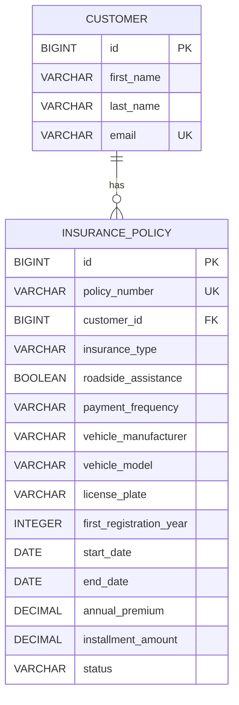

# HIMS – Insurance Management System

HIMS is a full-stack insurance management application developed with **Java 21, Spring Boot, Angular 22, TypeScript, PostgreSQL, and Docker**.

The application provides customer management and a demonstration of motor vehicle insurance administration, including policy management, premium calculation, and PDF document generation.

The project demonstrates full-stack software development concepts such as REST API design, layered architecture, authentication, role-based authorization, database relationships, automated testing, containerization, and Continuous Integration (CI).

> **Disclaimer:** HIMS is an independent educational portfolio project. It is not an official HUK-COBURG application. Insurance products, premiums, and calculations are simplified demonstration examples.

## Tech Stack

### Backend
- Java 21
- Spring Boot
- Spring Data JPA / Hibernate
- Spring Security
- Maven
- PostgreSQL
- OpenPDF

### Frontend
- Angular 22
- TypeScript
- HTML / SCSS
- Angular Router
- Angular HttpClient
- Angular Forms

### Testing
- JUnit 5
- Mockito
- Spring Boot Test / MockMvc
- Testcontainers
- Vitest

### DevOps
- Docker
- Docker Compose
- Nginx
- GitHub Actions (CI)

## Features

### Customer Management

- Create, read, update, and delete customers (CRUD)
- Validate customer information
- Prevent duplicate email addresses
- Store customer information in PostgreSQL
- Handle errors using appropriate HTTP status codes

### Insurance Policy Management

- Create motor vehicle insurance policies
- Display existing insurance policies
- Update insurance policy information
- Delete insurance policies
- Assign insurance policies to customers
- Automatically generate policy numbers
- Store insurance policies in PostgreSQL

### Insurance Products

The demonstration supports three insurance coverage options:

| Coverage | Demo Base Premium |
|---|---:|
| Liability (Haftpflicht) | €300/year |
| Partial Coverage (Teilkasko) | €450/year |
| Full Coverage (Vollkasko) | €650/year |

Additional options:

- Roadside assistance (Schutzbrief): +€30/year
- Yearly payment: No surcharge
- Half-yearly payment: 3% surcharge
- Quarterly payment: 5% surcharge

**Premium calculations are performed in the Spring Boot backend**, ensuring that business logic is not dependent on frontend calculations.

All premiums are fictional demonstration values.

### PDF Export

- Generate insurance policy documents in PDF format
- Include policy number, customer reference, vehicle information, coverage, and premium
- Download PDF documents directly from the Angular frontend
- Generate PDFs on the server using OpenPDF

### Security

- Authentication using Spring Security
- Role-based authorization with ADMIN and USER roles
- ADMIN can create, update, and delete customers and insurance policies
- USER has read-only access to customer and policy information
- Authorization rules are enforced in the backend
- Protected Angular routes

### Additional Features

- RESTful API
- Responsive user interface
- Automated backend and frontend tests
- Docker-based application deployment
- GitHub Actions CI pipeline

## Architecture

HIMS uses a **layered backend architecture** and a **component-based frontend architecture**.

### System Architecture

```text
                  Angular 22 Frontend
                   (TypeScript / SCSS)
                           |
                           | HTTP / REST
                           v
                      Nginx Proxy
                           |
                           v
                 Spring Boot Backend
                           |
                           v
                    Spring Security
                           |
                           v
                     REST Controllers
                           |
                           v
                      Service Layer
                  /                \
                 v                  v
        Business Logic          PDF Generation
                 |
                 v
           Repository Layer
                 |
                 v
             PostgreSQL
```

### Backend Architecture

**Controller Layer**

Handles HTTP requests and returns API responses.

Examples:
- CustomerController
- InsurancePolicyController
- PremiumController

**Service Layer**

Implements application business logic.

Examples:
- CustomerService
- InsurancePolicyService
- PremiumCalculator
- InsurancePolicyPdfService

**Repository Layer**

Provides database access through Spring Data JPA.

**Entity Layer**

Represents persistent database objects.

Examples:
- Customer
- InsurancePolicy

**DTO Layer**

Transfers data between frontend and backend without exposing JPA entities directly.

**Security Layer**

Handles authentication, authorization, and access control.

### Frontend Architecture

The Angular frontend uses a component-based architecture.

- **Components:** Display the interface and handle user interactions.
- **Services:** Communicate with REST endpoints.
- **Models and Interfaces:** Define TypeScript data structures.
- **Guards:** Protect routes based on authentication and roles.
- **Interceptors:** Handle authentication-related HTTP requests.

## Database Design

HIMS uses **PostgreSQL 16** as its relational database and **Spring Data JPA / Hibernate** for data persistence.

The database currently contains two main entities: `Customer` and `InsurancePolicy`.

### Customer Table

Stores customer information.

| Column | Type | Constraints |
|---|---|---|
| id | BIGINT | Primary Key |
| first_name | VARCHAR(255) | NOT NULL |
| last_name | VARCHAR(255) | NOT NULL |
| email | VARCHAR(255) | NOT NULL, UNIQUE |

### Insurance Policy Table

Stores insurance contracts associated with customers.

| Column | Type | Constraints |
|---|---|---|
| id | BIGINT | Primary Key |
| policy_number | VARCHAR(255) | NOT NULL, UNIQUE |
| customer_id | BIGINT | Foreign Key |
| insurance_type | VARCHAR(255) | Insurance coverage |
| roadside_assistance | BOOLEAN | Roadside assistance option |
| payment_frequency | VARCHAR(255) | Payment frequency |
| vehicle_manufacturer | VARCHAR(255) | Vehicle manufacturer |
| vehicle_model | VARCHAR(255) | Vehicle model |
| license_plate | VARCHAR(255) | Vehicle registration number |
| first_registration_year | INTEGER | First registration year |
| start_date | DATE | Insurance start date |
| end_date | DATE | Insurance end date |
| annual_premium | DECIMAL | Annual insurance premium |
| installment_amount | DECIMAL | Payment installment |
| status | VARCHAR(255) | Contract status |

### Entity Relationship

The entities have a **One-to-Many (1:N) relationship**:

- One customer can have multiple insurance policies.
- Each insurance policy belongs to exactly one customer.
- The `customer_id` foreign key connects an insurance policy to its customer.



The complete entity relationship diagram is available in `docs/ER-Diagram.md`.
## REST API

### Customer Endpoints

| Method | Endpoint | Description |
|---|---|---|
| GET | `/api/customers` | Get all customers |
| GET | `/api/customers/{id}` | Get customer by ID |
| POST | `/api/customers` | Create customer |
| PUT | `/api/customers/{id}` | Update customer |
| DELETE | `/api/customers/{id}` | Delete customer |

### Insurance Policy Endpoints

| Method | Endpoint | Description |
|---|---|---|
| GET | `/api/policies` | Get all policies |
| GET | `/api/policies/{id}` | Get policy by ID |
| GET | `/api/policies/customer/{customerId}` | Get policies by customer |
| POST | `/api/policies` | Create policy |
| PUT | `/api/policies/{id}` | Update policy |
| DELETE | `/api/policies/{id}` | Delete policy |
| POST | `/api/policies/quote` | Calculate insurance premium |
| GET | `/api/policies/{id}/pdf` | Download policy as PDF |

## Project Structure

```text
HIMS/
├── .github/
│   └── workflows/
│       └── ci.yml
│
├── backend/
│   └── customer-service/
│       ├── src/
│       ├── pom.xml
│       └── Dockerfile
│
├── frontend/
│   └── hims-web/
│       ├── src/
│       ├── package.json
│       ├── angular.json
│       └── Dockerfile
│
├── docs/
│   └── ER-Diagram.md
│
├── compose.yaml
└── README.md
```

## Getting Started

### Prerequisites

Install:

- Git
- Docker
- Docker Compose

Java, Maven, and Node.js do not need to be installed locally when running the application through Docker Compose.

### 1. Clone the Repository

```bash
git clone https://github.com/Huse1n/HIMS.git
cd HIMS
```

### 2. Configure Environment Variables

Create a `.env` file in the project root:

```env
DB_PASSWORD=your_database_password
HIMS_ADMIN_PASSWORD=your_admin_password
HIMS_USER_PASSWORD=your_user_password
```

The `.env` file should not be committed to Git.

### 3. Start the Application

Build and start the containers:

```bash
docker compose up -d --build
```

Docker Compose starts:

1. PostgreSQL database
2. Spring Boot backend
3. Angular frontend served by Nginx

For subsequent starts without source code changes:

```bash
docker compose up -d
```

### 4. Access the Application

Open the application in your browser:

`http://localhost:4200`

Log in using the configured ADMIN or USER account.

### 5. Stop the Application

```bash
docker compose down
```

View logs:

```bash
docker compose logs -f
```

## Testing

HIMS includes automated backend and frontend tests.

### Backend Testing

Technologies:

- JUnit 5
- Mockito
- Spring Boot Test
- MockMvc
- Testcontainers

The existing test suite covers customer management, validation, REST endpoints, and database integration.

Run backend tests:

```bash
cd backend/customer-service
./mvnw clean verify
```

### Frontend Testing

Technologies:

- Vitest
- Angular TestBed

The existing frontend tests cover customer management services, HTTP requests, error handling, and components.

Run frontend tests:

```bash
cd frontend/hims-web
npm ci
npm test -- --watch=false
```

## Continuous Integration

HIMS uses GitHub Actions to automate testing and building.

The CI pipeline runs on:

- Pushes to the `main` branch
- Pull requests targeting `main`

### Backend CI

1. Set up Java 21.
2. Start PostgreSQL 16.
3. Execute Maven tests.

### Frontend CI

1. Set up Node.js 24.
2. Install dependencies.
3. Execute Angular tests.
4. Build the frontend.

Configuration: 

`.github/workflows/ci.yml`

## Future Improvements

Potential enhancements include:

- Additional automated tests for insurance policy management
- PDF generation tests
- Database migrations with Flyway
- Pagination and sorting
- JWT-based authentication
- Automated deployment (CD)

## Author

Developed as a full-stack software engineering portfolio project to demonstrate practical experience with Java, Spring Boot, Angular, PostgreSQL, REST APIs, security, testing, and Docker.
