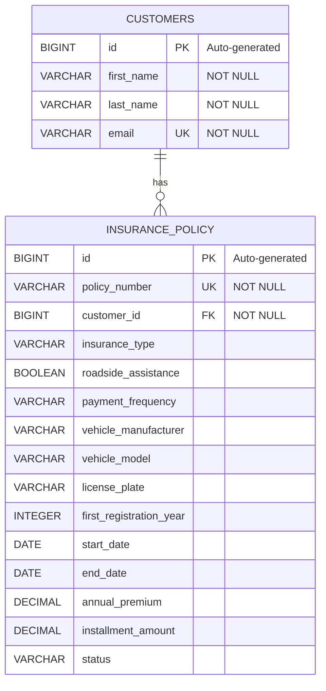

# HIMS - Entity Relationship Diagram

## Database: hims_customer_db

HIMS uses **PostgreSQL 16** and **Spring Data JPA / Hibernate** for relational data persistence.

The database contains two main entities:

- `Customer` – Stores customer information.
- `InsurancePolicy` – Stores motor vehicle insurance contracts.

## Entity Relationship Diagram



## Database Relationships

### Customer → InsurancePolicy

**Relationship type: One-to-Many (1:N)**

- One customer can have multiple insurance policies.
- Each insurance policy belongs to exactly one customer.
- The `customer_id` column is a foreign key referencing `customers.id`.

### Example

A customer may have multiple insured vehicles:

```text
Customer: Max Mustermann (ID: 1)
    |
    +-- Policy KFZ-A12B34C5 (BMW 320d)
    |
    +-- Policy KFZ-D67E89F0 (VW Golf)
    |
    +-- Policy KFZ-1234ABCD (Audi A4)
```

## Database Constraints

### Customers

- **Primary Key:** `id`
- **Unique Key:** `email`
- **Required Fields:** `first_name`, `last_name`, `email`

### Insurance Policies

- **Primary Key:** `id`
- **Unique Key:** `policy_number`
- **Foreign Key:** `customer_id` references `customers.id`
- **Required Relationship:** Every insurance policy must belong to a customer.

## JPA Relationship Mapping

The relationship is implemented using Spring Data JPA / Hibernate.

In `InsurancePolicy.java`:

```java
@ManyToOne
@JoinColumn(name = "customer_id", nullable = false)
private Customer customer;
```

This annotation creates a many-to-one relationship between insurance policies and customers.

The relationship is managed through the `customer_id` foreign key in PostgreSQL.

## Data Access

The application uses Spring Data JPA repositories for database operations:

- `CustomerRepository`
- `InsurancePolicyRepository`

Business logic is implemented in the corresponding service classes.

This separation follows the layered architecture:

```text
REST Controller
      |
      v
Service Layer
      |
      v
Repository Layer
      |
      v
PostgreSQL
```
