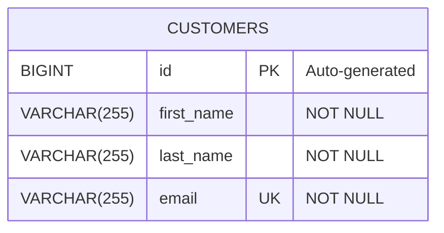

# HIMS — Entity Relationship Diagram

## Database: hims_customer_db

The HIMS Customer Service currently contains one entity: `Customer`.

## Constraints

- **Primary Key:** `id`
- **Unique Key:** `email`
- **Required fields:** `first_name`, `last_name`, `email`

## Relationships

Currently, the database contains only the `customers` table.
Therefore, no relationships or foreign keys are defined.
